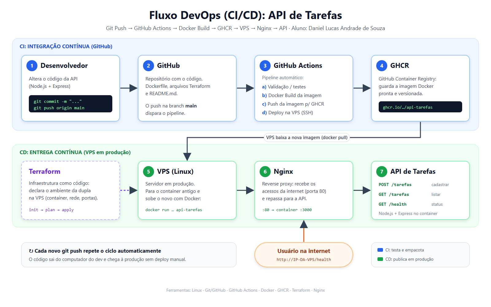

# API de Tarefas: Pipeline CI/CD

**Aluno:** Daniel Lucas Andrade de Souza

API simples em **Node.js + Express** usada para praticar um pipeline de **CI/CD com GitHub Actions**. A cada `git push` na branch `main`, o pipeline testa o código, constrói a imagem Docker, publica no **GitHub Container Registry (GHCR)** e atualiza a aplicação na VPS.

## Fluxo



```
Git Push → GitHub Actions → Docker Build → GHCR → VPS → Nginx → API
```

## Endpoints

| Método | Rota | Descrição |
|---|---|---|
| `GET` | `/health` | Verifica se a aplicação está funcionando |
| `GET` | `/tarefas` | Lista as tarefas cadastradas |
| `POST` | `/tarefas` | Cadastra uma tarefa (`{ "titulo": "...", "descricao": "..." }`) |

## Pipeline (`.github/workflows/ci-cd.yml`)

| Job | O que faz |
|---|---|
| **1. Validação e testes** | Instala as dependências (`npm ci`) e roda os testes automatizados (`npm test`) |
| **2. Docker Build e push no GHCR** | Constrói a imagem com o `Dockerfile` e publica em `ghcr.io/danlucas0/api-tarefas-devops` (tags `latest` e o hash do commit) |
| **3. Deploy na VPS** | Acessa a VPS por SSH, baixa a nova imagem, recria o container e testa o `/health` |

Os jobs dependem um do outro: se os testes falharem, nada é publicado.

O deploy só roda quando os secrets da VPS estão cadastrados em *Settings → Secrets and variables → Actions*:

| Secret | Conteúdo |
|---|---|
| `VPS_HOST` | IP da VPS |
| `VPS_USER` | Usuário SSH |
| `VPS_SSH_KEY` | Chave SSH privada |

## Rodando localmente

```bash
npm install
npm test        # roda os testes
npm start       # sobe a API em http://localhost:3000
```

Com Docker:

```bash
docker build -t api-tarefas .
docker run -p 3000:3000 api-tarefas
```

Usando a imagem publicada pelo pipeline:

```bash
docker run -p 3000:3000 ghcr.io/danlucas0/api-tarefas-devops:latest
```

## Conceitos aplicados

- **CI (Integração Contínua):** todo push é testado automaticamente.
- **CD (Entrega Contínua):** a versão aprovada é empacotada e levada à produção sem deploy manual.
- **Containers:** a aplicação roda igual em qualquer máquina com Docker.
- **Registry (GHCR):** a imagem fica versionada e disponível para o servidor baixar.
